<p align="center">
  <picture>
    <source media="(prefers-color-scheme: dark)" srcset=".github/marca/banner-en-oscuro.svg">
    
  </picture>
</p>

<p align="center"><a href="README.md">Español</a> · <b>English</b> · <a href="https://molinosuite.org/en/">molinosuite.org</a></p>

<p align="center">
  <a href="LICENSE"></a>
  
  
  
  <a href="https://github.com/sponsors/CuevasTech"></a>
</p>

<h3 align="center">Documents, spreadsheets, presentations and PDF.<br>No subscriptions, no accounts and no uploading your files to anyone’s cloud.</h3>

<br>

## The apps

Each sail of the windmill is an app. In the Microsoft Store: **Molino PDF**, if you only want PDF, or **Molino Suite**, with all of them.

<table>
  <tr>
    <td align="center" width="25%" valign="top">
      <a href="docs/pdf.en.md"></a>
      <h3><a href="docs/pdf.en.md">Molino PDF</a></h3>
      <p>Read, fill in, sign, edit and organize your PDFs.</p>
      <a href="https://apps.microsoft.com/detail/9NRTWZFHG67N"></a>
    </td>
    <td align="center" width="25%" valign="top">
      <a href="https://molinosuite.org/en/docs/"></a>
      <h3><a href="https://molinosuite.org/en/docs/">Molino Docs</a></h3>
      <p>Letters, reports and any document, Word files included.</p>
      
    </td>
    <td align="center" width="25%" valign="top">
      <a href="https://molinosuite.org/en/sheets/"></a>
      <h3><a href="https://molinosuite.org/en/sheets/">Molino Sheets</a></h3>
      <p>Accounts, budgets, lists and tables, Excel files included.</p>
      
    </td>
    <td align="center" width="25%" valign="top">
      <a href="https://molinosuite.org/en/slides/"></a>
      <h3><a href="https://molinosuite.org/en/slides/">Molino Slides</a></h3>
      <p>For class, for work or for an idea, PowerPoint files included.</p>
      
    </td>
  </tr>
</table>

## The same rules, for all four

<table>
  <tr>
    <td width="33%" valign="top"><h3>🎁 Free forever</h3>No paid version, no trial periods and no subscriptions. Ever.</td>
    <td width="33%" valign="top"><h3>🏠 Your files stay with you</h3>Everything runs on your computer, even offline. Nothing is uploaded to anyone’s cloud.</td>
    <td width="33%" valign="top"><h3>🙅 No accounts</h3>No email, no sign-up, no logging in. Install it and use it.</td>
  </tr>
  <tr>
    <td valign="top"><h3>📂 Opens what people send you</h3>Designed for Office documents and for open formats.</td>
    <td valign="top"><h3>🧠 AI on your computer, if you want</h3>Optional and off by default. What you ask never leaves your computer.</td>
    <td valign="top"><h3>🔍 Open source</h3>Free software: anyone can review it, and no one can take it away from you.</td>
  </tr>
</table>

## The first one: Molino PDF

<p align="center">
  <a href="docs/pdf.en.md"></a>
</p>

<p align="center">Forms that do the math for you, digital certificate signatures, scanning with your phone and AI that never leaves your computer.<br><b><a href="docs/pdf.en.md">Everything Molino PDF does →</a></b></p>

## Automate tasks, in every app

**The `molino` command** works with the files of every app without opening any windows, from PowerShell, a `.bat` file or Windows Task Scheduler:

- **Convert:** Word, Excel, PowerPoint and OpenDocument to PDF or to another office format (`.docx` to `.odt`, `.xlsx` to `.csv`…), with Molino Suite; PDF to Word, text or images; photos to PDF.
- **Work with PDFs:** merge, extract, split, rotate, compress, run OCR, add a watermark or page numbers, password-protect and remove hidden data.
- **Signatures and forms:** sign with a Windows certificate or a `.pfx` file, verify signatures and fill in forms from a JSON file.
- **Print**, documents, spreadsheets and presentations too.

```powershell
molino convert accounts.xlsx accounts.pdf
molino sign contract.pdf -o signed.pdf --certificate "John Smith"
Get-ChildItem *.docx | ForEach-Object { molino convert $_.FullName ($_.BaseName + ".pdf") }
```

**Your own scripts** in Docs, Sheets and Slides: JavaScript with the ONLYOFFICE document API, which works on the open document with no access to your files or the internet; Ctrl+Z undoes what it does. They live in the **Developer** tab (**Scripts**, in Slides), which is hidden by default and turned on in Settings. In Docs it also has form controls, and in Sheets, data validation, cell locking and sheet protection. Macros that come inside documents never run.

It’s all in the [command-line manual](docs/linea-de-ordenes.md) (in Spanish, with an [English summary](docs/linea-de-ordenes.md#english-summary)).

## Install

- **Molino PDF**: [in the Microsoft Store](https://apps.microsoft.com/detail/9NRTWZFHG67N), or with `winget install 9NRTWZFHG67N`. Free, no account and no administrator rights; new versions arrive on their own through the Store.
- **Molino Suite** (Molino PDF, Docs, Sheets and Slides): coming soon to the Microsoft Store. To hear about it, click **Watch → Custom → Releases** at the top, or give it a ⭐.

For 64-bit Windows 10 and 11. Linux, later on.

## Privacy

No accounts, no ads and no telemetry. Your documents never leave your computer: the apps only go online when you ask them to (a signature timestamp or a certificate check, sending feedback, downloading the AI or a free font a document is missing) and to check for new versions, which you can turn off in Settings. Every file opens in an isolated Windows sandbox. It’s all in the [privacy policy](https://molinosuite.org/en/privacy/).

## Support Molino

Molino is free and will stay free. If you find it useful, tell someone about it, give it a ⭐ or buy me a coffee on [GitHub Sponsors](https://github.com/sponsors/CuevasTech). Ideas or something not working? Tell us in [Issues](https://github.com/MolinoSuite/Molino/issues) or at [info@molinosuite.org](mailto:info@molinosuite.org).

## License

Molino is free software under the [GNU AGPL, version 3 or later](LICENSE), and comes with no warranty. © 2026 CuevasTech. The names and logos aren’t covered by the license: what you can do with them is in [TRADEMARKS.md](TRADEMARKS.md#molino-name-and-logo).

Docs, Sheets and Slides are based on ONLYOFFICE software by Ascensio System SIA (AGPL-3.0), in a version modified by Molino that runs on your computer. How it’s built and what changes is in [`office/`](office/).

<details>
<summary><b>For developers: build from source</b></summary>

<br>

You need Node 22.12 or later and Python 3.12 or later. In PowerShell:

```powershell
npm ci --ignore-scripts
npm run electron:install
py -m venv engine\.venv
engine\.venv\Scripts\python.exe -m pip install --no-deps --only-binary :all: --require-hashes -r engine\requirements.txt -r engine\requirements-nodeps.txt
engine\.venv\Scripts\python.exe -m pip install --only-binary :all: --require-hashes -r engine\requirements-build.txt
powershell -File scripts\fetch-tessdata.ps1
npm run dist:store
```

The Molino PDF package for the Microsoft Store (MSIX, unsigned: the Store signs it) ends up in `dist\`. The Molino Suite one, with Docs, Sheets and Slides, also needs the office engine (`engine\.venv\Scripts\python.exe -I office\build.py`) and comes out with `npm run dist:suite`, in `dist-suite\`.

</details>
