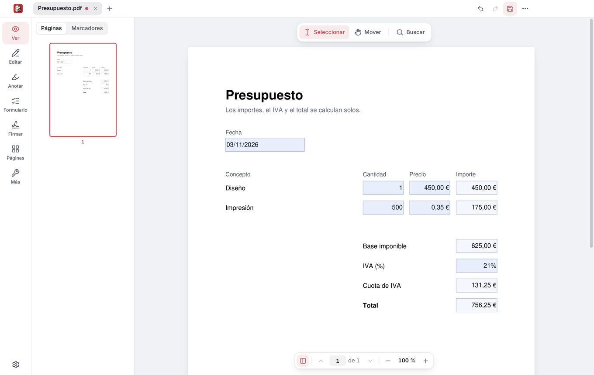
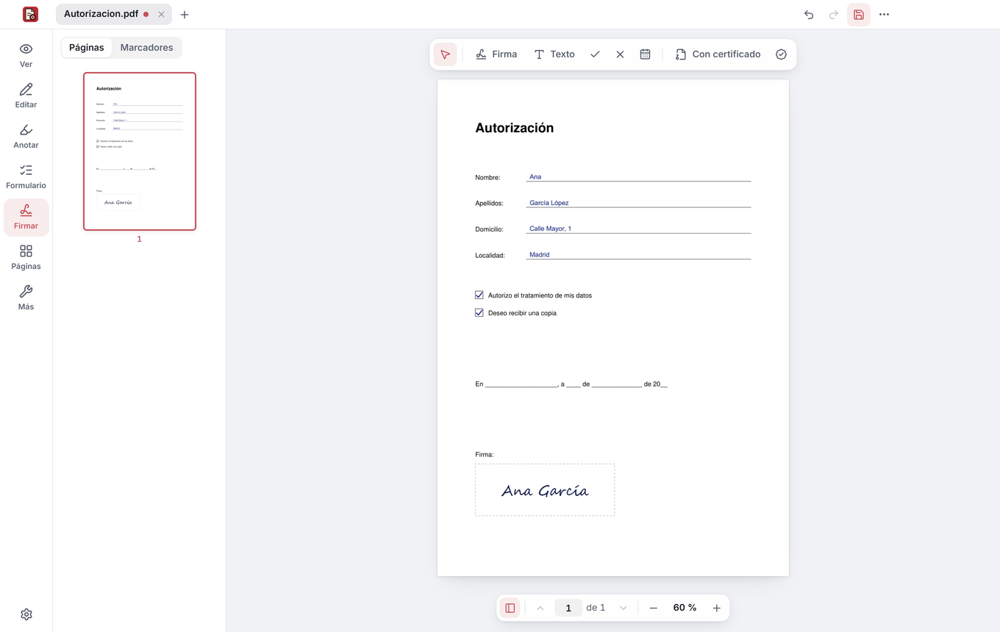
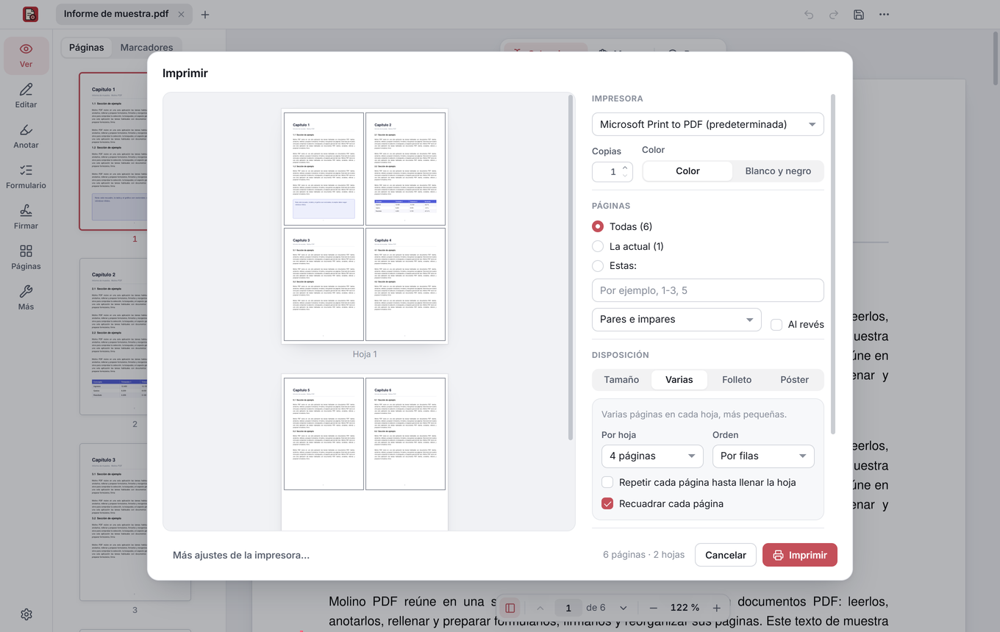

<div align="center">

[Español](README.md) · **English**

<picture>
  <source media="(prefers-color-scheme: dark)" srcset=".github/marca/molino-oscuro.svg">
  
</picture>

### They’re not giants, they’re windmills.

A free office suite for your computer: documents, spreadsheets, presentations and PDF.<br>
No ads, no accounts, no subscriptions, and your files stay on your computer.

</div>

| | App | |
|:-:|---|---|
|  | **Molino PDF**<br>Read, fill in, sign, edit and organize your PDFs. | Windows · [more below](#molino-pdf) |
|  | **Molino Docs**<br>Letters, reports and any other document. | In development |
|  | **Molino Sheets**<br>Accounts, budgets and lists. | In development |
|  | **Molino Slides**<br>Presentations. | In development |

Molino is named after the windmills of La Mancha. Molino PDF comes first; Docs, Sheets and Slides are on the way.

## Molino PDF

**Everything you need to do with a PDF, in one place.**<br>
Read, fill in, sign, edit and organize your PDFs on Windows. Free, no ads, no accounts, and your documents are never uploaded anywhere.

> [!NOTE]
> **The first version is coming very soon.** To hear about it, click **Watch → Custom → Releases** at the top, or give it a ⭐.

<div align="center">

</div>

### What you can do

- **Fill in forms**, including the ones that calculate amounts, tax and totals by themselves, and write on any PDF even if it has no fields to fill in.
- **Sign** by hand (drawing, typing your name or with a photo of your signature) or with your **digital certificate**, such as the one from Spain’s FNMT, with a timestamp included.
- **Edit** the text of the PDF itself and add text, images and shapes.
- **Annotate**: highlight, underline, strike through, notes and freehand drawing.
- **Organize pages**: reorder, rotate, delete, extract, split and combine documents.
- **Print** with a preview: multiple pages per sheet (also the same page repeated, for labels or flyers), booklets to fold, posters across several sheets, other paper sizes and two-sided.
- **Scan paper documents** with photos from your phone or with your scanner or all-in-one printer: Molino PDF finds the sheet in each photo, straightens it, removes the shadows and makes it look freshly scanned.
- **AI on your computer, optional**: summarizes the document, answers questions pointing to the pages each answer comes from, searches by meaning, translates and improves texts and finds personal data to redact. It works offline: the models are only downloaded if you turn it on, and your documents never leave your computer.
- And also: recognize the text of scanned documents (OCR), protect with a password, truly redact, compress and convert to Word or images.

Molino PDF is available in English and Spanish, and follows the language of Windows.

<p align="center">
  
  
</p>

### Your documents stay on your computer

Molino PDF works offline: it doesn’t upload your PDFs to any server or ask you for an account. It only uses the Internet when you ask it to (the timestamp of a signature, which receives a fingerprint of the document, never the document itself; feedback you send us; or downloading the AI models, from Hugging Face) and to let you know about new versions. The AI runs on your computer too: what you ask and what it answers never leave it.

On top of that, each PDF is opened in an isolated Windows sandbox, designed so that a booby-trapped file can’t touch your other files or connect to the Internet.

### Installation

1. Download **MolinoPDF-Setup** from the [latest version](https://github.com/MolinoSuite/Molino/releases/latest).
2. Open it and follow the steps. You don’t need to be an administrator.
3. Done. When there’s a new version, Molino PDF will let you know.

**Portable version:** if you’d rather not install anything, download [MolinoPDF-Portable.zip](https://github.com/MolinoSuite/Molino/releases/latest/download/MolinoPDF-Portable.zip), unzip it in any folder and open `MolinoPDF.exe`. It keeps its settings in that folder and changes nothing in Windows.

For 64-bit Windows 10 and 11, including Windows 11 on Arm laptops.

## Ideas or something not working?

Tell us from Molino PDF, in the **…** menu → **Send feedback**, in [Issues](https://github.com/MolinoSuite/Molino/issues) or at [info@molinosuite.org](mailto:info@molinosuite.org). And if you find Molino useful, give it a ⭐: it helps more people find it.

## Support Molino

Molino is free and will stay free, with no ads, no subscriptions and no paid versions. If you find it useful, you can buy me a coffee on [GitHub Sponsors](https://github.com/sponsors/CuevasTech).

## License

Molino is free software under the [GNU AGPL, version 3 or later](LICENSE), and comes with no warranty. © 2026 CuevasTech.<br>
It includes third-party components with their own licenses: the list is in Molino PDF, under **About Molino PDF → Third-party components**.<br>
The license doesn’t cover the names or the logos: what you can do with them is in [TRADEMARKS.md](TRADEMARKS.md#molino-name-and-logo).

<details>
<summary>Build from source</summary>

<br>

You need Node 22.12 or later and Python 3.12 or later. In PowerShell:

```powershell
npm ci --ignore-scripts
npm run electron:install
py -m venv engine\.venv
engine\.venv\Scripts\python.exe -m pip install --no-deps --only-binary :all: --require-hashes -r engine\requirements.txt -r engine\requirements-nodeps.txt
engine\.venv\Scripts\python.exe -m pip install --only-binary :all: --require-hashes -r engine\requirements-build.txt
powershell -File scripts\fetch-tessdata.ps1
npm run dist
```

The installer ends up in `dist\`.

</details>
