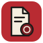
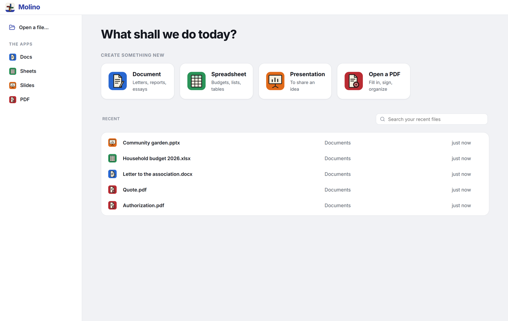

<p align="center">
  <picture>
    <source media="(prefers-color-scheme: dark)" srcset=".github/marca/banner-en-oscuro.svg">
    
  </picture>
</p>

<p align="center"><a href="README.md">Español</a> · <b>English</b> · <a href="https://molinosuite.org/en/">molinosuite.org</a></p>

<p align="center">
  <a href="LICENSE"></a>
  
  
  
</p>

<h3 align="center">Write, do the numbers, present and sign.<br>Four free apps for your computer, with no subscriptions, no accounts and nothing uploaded to the cloud.</h3>

<p align="center"><b><a href="https://molinosuite.org/en/download/">⬇&nbsp; Get Molino for free</a></b> · in the Microsoft Store</p>

<br>

## Four apps, one install

Each sail of the windmill is an app, and they all open and save the files you already use.

<table>
  <tr>
    <td align="center" width="25%" valign="top">
      <a href="https://molinosuite.org/en/docs/"></a>
      <h3><a href="https://molinosuite.org/en/docs/">Molino Docs</a></h3>
      <p>Letters, assignments, reports and resumes. Word files too.</p>
    </td>
    <td align="center" width="25%" valign="top">
      <a href="https://molinosuite.org/en/sheets/"></a>
      <h3><a href="https://molinosuite.org/en/sheets/">Molino Sheets</a></h3>
      <p>Household accounts, budgets, invoices and lists. Excel files too.</p>
    </td>
    <td align="center" width="25%" valign="top">
      <a href="https://molinosuite.org/en/slides/"></a>
      <h3><a href="https://molinosuite.org/en/slides/">Molino Slides</a></h3>
      <p>For class, for work or to get an idea across. PowerPoint files too.</p>
    </td>
    <td align="center" width="25%" valign="top">
      <a href="https://molinosuite.org/en/pdf/"></a>
      <h3><a href="https://molinosuite.org/en/pdf/">Molino PDF</a></h3>
      <p>Fill in, sign with your certificate, edit and organize your PDFs.</p>
    </td>
  </tr>
</table>

<p align="center">
  <a href="https://molinosuite.org/en/"></a>
</p>

## The same rules, for all four

<table>
  <tr>
    <td width="33%" valign="top"><h3>🎁 Free forever</h3>No paid version, no trial periods and no subscriptions. Ever.</td>
    <td width="33%" valign="top"><h3>🏠 Your files stay with you</h3>Everything runs on your computer, even offline. Nothing is uploaded to anyone’s cloud.</td>
    <td width="33%" valign="top"><h3>🙅 No accounts</h3>No email, no sign-up, no logging in. Install it and use it.</td>
  </tr>
  <tr>
    <td valign="top"><h3>📂 Opens what people send you</h3>Office documents, spreadsheets and presentations, open formats and any PDF.</td>
    <td valign="top"><h3>✍️ From document to submission</h3>Write it, save it as PDF, sign it with your certificate and check it before you submit it.</td>
    <td valign="top"><h3>🔍 Open source</h3>Free software: anyone can review it, and no one can take it away from you.</td>
  </tr>
</table>

## Install

Free from the Microsoft Store: go to **[molinosuite.org/en/download](https://molinosuite.org/en/download/)** and choose **Molino Suite**, with all four apps, or **Molino PDF**, if you only need PDF. No account and no administrator rights, and new versions arrive on their own.

Also with winget: `winget install "Molino Suite"` or `winget install "Molino PDF"`.

For 64-bit Windows 10 and 11. Linux and Mac, later on.

## Privacy

No accounts, no ads and no telemetry. Your documents never leave your computer: the apps only go online when you ask them to (a signature timestamp or a certificate check, sending feedback, downloading the AI or a free font a document is missing) and to check for new versions, which you can turn off in Settings. Every file opens in an isolated Windows sandbox. It’s all in the [privacy policy](https://molinosuite.org/en/privacy/).

## Support Molino

Molino is free and will stay free. If you find it useful, tell someone about it, give it a ⭐ or buy me a coffee on [GitHub Sponsors](https://github.com/sponsors/CuevasTech). Ideas or something not working? Tell us in [Issues](https://github.com/MolinoSuite/Molino/issues) or at [info@molinosuite.org](mailto:info@molinosuite.org).

## License

Molino is free software under the [GNU AGPL, version 3 or later](LICENSE), and comes with no warranty. © 2026 CuevasTech. The names and logos aren’t covered by the license: what you can do with them is in [TRADEMARKS.md](TRADEMARKS.md#molino-name-and-logo).

Docs, Sheets and Slides are based on ONLYOFFICE software by Ascensio System SIA (AGPL-3.0), in a version modified by Molino that runs on your computer. How it’s built and what changes is in [`office/`](office/).

<details>
<summary><b>For advanced users: the command line and scripts</b></summary>

<br>

The `molino` command converts, merges, signs, fills in and prints documents without opening any window, from PowerShell, a `.bat` file or Windows Task Scheduler. In Docs, Sheets and Slides you can save your own scripts (the **Advanced** tab, turned on in Settings); macros inside documents never run. It’s all in the [command-line manual](https://molinosuite.org/en/command-line/).

</details>

<details>
<summary><b>For developers: build from source</b></summary>

<br>

You need Node 22.12 or later and Python 3.12 or later. In PowerShell:

```powershell
npm ci --ignore-scripts
npm run electron:install
py -m venv engine\.venv
engine\.venv\Scripts\python.exe -m pip install --no-deps --only-binary :all: --require-hashes -r engine\requirements.txt -r engine\requirements-nodeps.txt
engine\.venv\Scripts\python.exe -m pip install --only-binary :all: --require-hashes -r engine\requirements-build.txt
powershell -File scripts\fetch-tessdata.ps1
npm run dist:store
```

The Molino PDF package for the Microsoft Store (MSIX, unsigned: the Store signs it) ends up in `dist\`. The Molino Suite one, with Docs, Sheets and Slides, also needs the office engine (`engine\.venv\Scripts\python.exe -I office\build.py`) and the dictionaries (`engine\.venv\Scripts\python.exe -I scripts\fetch-dictionaries.py`), and comes out with `npm run dist:suite`, in `dist-suite\`.

</details>
