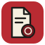
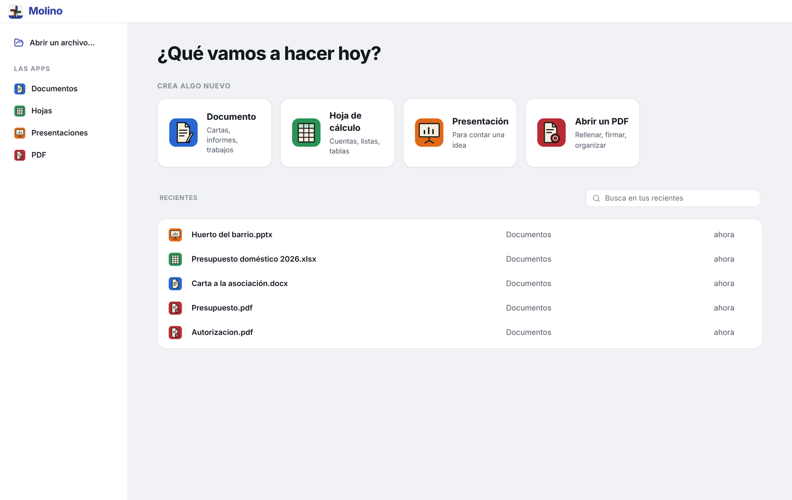

<p align="center">
  <picture>
    <source media="(prefers-color-scheme: dark)" srcset=".github/marca/banner-oscuro.svg">
    
  </picture>
</p>

<p align="center"><b>Español</b> · <a href="README.en.md">English</a> · <a href="https://molinosuite.org">molinosuite.org</a></p>

<p align="center">
  <a href="LICENSE"></a>
  
  
  
</p>

<h3 align="center">Escribe, haz cuentas, presenta y firma.<br>Cuatro apps gratis para tu ordenador, sin suscripciones, sin cuentas y sin subir nada a la nube.</h3>

<p align="center"><b><a href="https://molinosuite.org/descargar/">⬇&nbsp; Descarga Molino gratis</a></b> · en la Microsoft Store</p>

<br>

## Cuatro apps, una sola instalación

Cada aspa del molino es una app, y todas abren y guardan los archivos que ya usas.

<table>
  <tr>
    <td align="center" width="25%" valign="top">
      <a href="https://molinosuite.org/documentos/"></a>
      <h3><a href="https://molinosuite.org/documentos/">Molino Documentos</a></h3>
      <p>Cartas, trabajos, informes y currículums. También los de Word.</p>
    </td>
    <td align="center" width="25%" valign="top">
      <a href="https://molinosuite.org/hojas/"></a>
      <h3><a href="https://molinosuite.org/hojas/">Molino Hojas</a></h3>
      <p>Cuentas de casa, presupuestos, facturas y listas. También las de Excel.</p>
    </td>
    <td align="center" width="25%" valign="top">
      <a href="https://molinosuite.org/presentaciones/"></a>
      <h3><a href="https://molinosuite.org/presentaciones/">Molino Presentaciones</a></h3>
      <p>Para clase, para el trabajo o para contar una idea. También las de PowerPoint.</p>
    </td>
    <td align="center" width="25%" valign="top">
      <a href="https://molinosuite.org/pdf/"></a>
      <h3><a href="https://molinosuite.org/pdf/">Molino PDF</a></h3>
      <p>Rellena, firma con tu certificado, edita y organiza tus PDF.</p>
    </td>
  </tr>
</table>

<p align="center">
  <a href="https://molinosuite.org"></a>
</p>

## Las mismas reglas, para las cuatro

<table>
  <tr>
    <td width="33%" valign="top"><h3>🎁 Gratis para siempre</h3>Sin versión de pago, sin periodos de prueba y sin suscripciones. Nunca.</td>
    <td width="33%" valign="top"><h3>🏠 Tus archivos, contigo</h3>Todo funciona en tu ordenador, también sin Internet. Nada se sube a la nube de nadie.</td>
    <td width="33%" valign="top"><h3>🙅 Sin cuentas</h3>Ni correo, ni registro, ni iniciar sesión. Lo instalas y lo usas.</td>
  </tr>
  <tr>
    <td valign="top"><h3>📂 Abre lo que te mandan</h3>Documentos, hojas y presentaciones de Office, los formatos abiertos y cualquier PDF.</td>
    <td valign="top"><h3>✍️ Del documento al trámite</h3>Escríbelo, guárdalo en PDF, fírmalo con tu certificado y compruébalo antes de presentarlo.</td>
    <td valign="top"><h3>🔍 Código abierto</h3>Software libre: cualquiera puede revisarlo, y nadie puede cerrártelo.</td>
  </tr>
</table>

## Instalar

Gratis desde la Microsoft Store: entra en **[molinosuite.org/descargar](https://molinosuite.org/descargar/)** y elige **Molino Suite**, con las cuatro apps, o **Molino PDF**, si solo quieres el PDF. Sin cuenta y sin permisos de administrador, y las versiones nuevas llegan solas.

También con winget: `winget install "Molino Suite"` o `winget install "Molino PDF"`.

Para Windows 10 y 11 de 64 bits. Linux y Mac, más adelante.

## Privacidad

Sin cuentas, sin anuncios y sin telemetría. Tus documentos no salen de tu equipo: las apps solo se conectan cuando tú lo pides (el sello de tiempo de una firma o la comprobación de un certificado, enviar un comentario, descargar la IA o una fuente libre que le falte a un documento) y para mirar si hay una versión nueva, algo que se desactiva en Ajustes. Cada archivo se abre en un espacio aislado de Windows. Lo tienes todo en la [política de privacidad](https://molinosuite.org/privacidad/).

## Apoya Molino

Molino es gratis y lo seguirá siendo. Si te resulta útil, cuéntaselo a alguien, dale una ⭐ o invítame a un café en [GitHub Sponsors](https://github.com/sponsors/CuevasTech). ¿Ideas o algo que no va bien? Cuéntalo en [Issues](https://github.com/MolinoSuite/Molino/issues) o en [info@molinosuite.org](mailto:info@molinosuite.org).

## Licencia

Molino es software libre con licencia [GNU AGPL, versión 3 o posterior](LICENSE), y se ofrece sin ninguna garantía. © 2026 CuevasTech. Los nombres y los logos no entran en la licencia: lo que puedes hacer con ellos está en [TRADEMARKS.md](TRADEMARKS.md#nombre-y-logo-de-molino).

Documentos, Hojas y Presentaciones se basan en el software ONLYOFFICE de Ascensio System SIA (AGPL-3.0), en una versión modificada por Molino que funciona en tu equipo. Cómo se arma y qué cambia está en [`office/`](office/).

<details>
<summary><b>Para usuarios avanzados: la línea de órdenes y los scripts</b></summary>

<br>

El comando `molino` convierte, une, firma, rellena e imprime documentos sin abrir ninguna ventana, desde PowerShell, un `.bat` o el Programador de tareas de Windows. En Documentos, Hojas y Presentaciones puedes guardar tus propios scripts (pestaña **Avanzado**, que se activa en Ajustes); las macros que traen los documentos nunca se ejecutan. Todo está en el [manual de la línea de órdenes](docs/linea-de-ordenes.md).

</details>

<details>
<summary><b>Para desarrolladores: compilar desde el código</b></summary>

<br>

Hace falta Node 22.12 o posterior y Python 3.12 o posterior. En PowerShell:

```powershell
npm ci --ignore-scripts
npm run electron:install
py -m venv engine\.venv
engine\.venv\Scripts\python.exe -m pip install --no-deps --only-binary :all: --require-hashes -r engine\requirements.txt -r engine\requirements-nodeps.txt
engine\.venv\Scripts\python.exe -m pip install --only-binary :all: --require-hashes -r engine\requirements-build.txt
powershell -File scripts\fetch-tessdata.ps1
npm run dist:store
```

El paquete de Molino PDF para la Microsoft Store (MSIX, sin firmar: lo firma la Store) queda en `dist\`. El de Molino Suite, con Documentos, Hojas y Presentaciones, necesita además el motor de oficina (`engine\.venv\Scripts\python.exe -I office\build.py`) y los diccionarios (`engine\.venv\Scripts\python.exe -I scripts\fetch-dictionaries.py`), y sale con `npm run dist:suite`, en `dist-suite\`.

</details>
