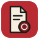
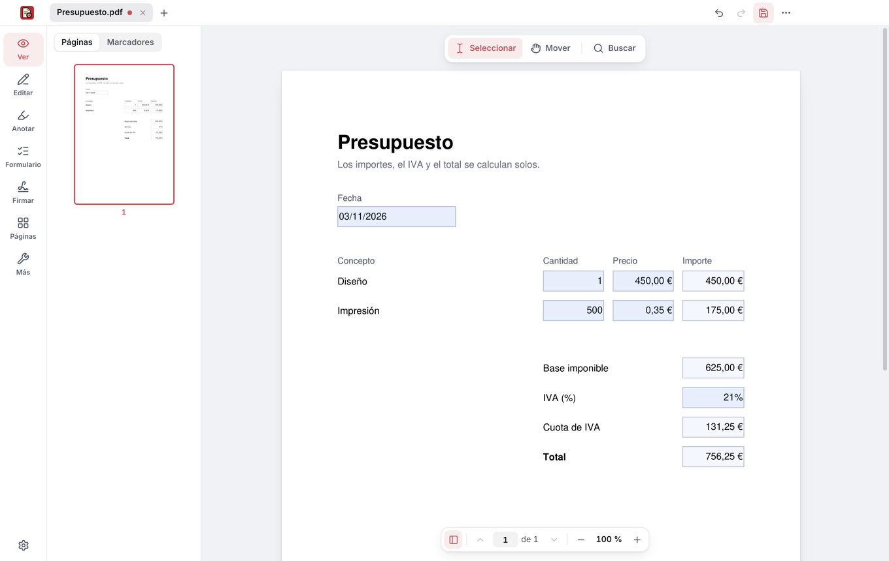

<p align="center">
  <picture>
    <source media="(prefers-color-scheme: dark)" srcset=".github/marca/banner-oscuro.svg">
    
  </picture>
</p>

<p align="center"><b>Español</b> · <a href="README.en.md">English</a> · <a href="https://molinosuite.org">molinosuite.org</a></p>

<p align="center">
  <a href="LICENSE"></a>
  
  
  
  <a href="https://github.com/sponsors/CuevasTech"></a>
</p>

<h3 align="center">Documentos, hojas de cálculo, presentaciones y PDF.<br>Sin suscripciones, sin cuentas y sin subir tus archivos a la nube de nadie.</h3>

<br>

## Las apps

Cada aspa del molino es una app. En la Microsoft Store: **Molino PDF**, si solo quieres el PDF, o **Molino Suite**, con todas.

<table>
  <tr>
    <td align="center" width="25%" valign="top">
      <a href="docs/pdf.md"></a>
      <h3><a href="docs/pdf.md">Molino PDF</a></h3>
      <p>Lee, rellena, firma, edita y organiza tus PDF.</p>
      <a href="https://apps.microsoft.com/detail/9NRTWZFHG67N"></a>
    </td>
    <td align="center" width="25%" valign="top">
      <a href="https://molinosuite.org/documentos/"></a>
      <h3><a href="https://molinosuite.org/documentos/">Molino Documentos</a></h3>
      <p>Cartas, informes y cualquier documento, también los de Word.</p>
      
    </td>
    <td align="center" width="25%" valign="top">
      <a href="https://molinosuite.org/hojas/"></a>
      <h3><a href="https://molinosuite.org/hojas/">Molino Hojas</a></h3>
      <p>Cuentas, presupuestos, listas y tablas, también las de Excel.</p>
      
    </td>
    <td align="center" width="25%" valign="top">
      <a href="https://molinosuite.org/presentaciones/"></a>
      <h3><a href="https://molinosuite.org/presentaciones/">Molino Presentaciones</a></h3>
      <p>Para clase, el trabajo o una idea, también las de PowerPoint.</p>
      
    </td>
  </tr>
</table>

## Las mismas reglas, para las cuatro

<table>
  <tr>
    <td width="33%" valign="top"><h3>🎁 Gratis para siempre</h3>Sin versión de pago, sin periodos de prueba y sin suscripciones. Nunca.</td>
    <td width="33%" valign="top"><h3>🏠 Tus archivos, contigo</h3>Todo funciona en tu ordenador, también sin Internet. Nada se sube a la nube de nadie.</td>
    <td width="33%" valign="top"><h3>🙅 Sin cuentas</h3>Ni correo, ni registro, ni iniciar sesión. Lo instalas y lo usas.</td>
  </tr>
  <tr>
    <td valign="top"><h3>📂 Abre lo que te mandan</h3>Pensadas para los documentos de Office y para los formatos abiertos.</td>
    <td valign="top"><h3>🧠 IA en tu equipo, si quieres</h3>Opcional y apagada de serie. Lo que le preguntas no sale de tu ordenador.</td>
    <td valign="top"><h3>🔍 Código abierto</h3>Software libre: cualquiera puede revisarlo, y nadie puede cerrártelo.</td>
  </tr>
</table>

## La primera: Molino PDF

<p align="center">
  <a href="docs/pdf.md"></a>
</p>

<p align="center">Formularios que hacen las cuentas solos, firma con certificado digital, escáner con el móvil e IA que no sale de tu ordenador.<br><b><a href="docs/pdf.md">Todo lo que hace Molino PDF →</a></b></p>

## Automatiza tareas, en todas las apps

**El comando `molino`** trabaja con los archivos de todas las apps sin abrir ninguna ventana, desde PowerShell, un `.bat` o el Programador de tareas de Windows:

- **Convertir:** Word, Excel, PowerPoint y OpenDocument a PDF o a otro formato de oficina (`.docx` a `.odt`, `.xlsx` a `.csv`…), con Molino Suite; PDF a Word, a texto o a imágenes; fotos a PDF.
- **Trabajar con PDF:** unir, extraer, dividir, girar, comprimir, pasar el OCR, poner marca de agua o números de página, proteger con contraseña y limpiar datos ocultos.
- **Firmas y formularios:** firmar con un certificado de Windows o un `.pfx`, verificar firmas y rellenar formularios desde un JSON.
- **Imprimir**, también documentos, hojas y presentaciones.

```powershell
molino convertir cuentas.xlsx cuentas.pdf
molino firmar contrato.pdf -o firmado.pdf --certificado "Juan Español"
Get-ChildItem *.docx | ForEach-Object { molino convertir $_.FullName ($_.BaseName + ".pdf") }
```

**Tus propios scripts** en Documentos, Hojas y Presentaciones: JavaScript con la API de documentos de ONLYOFFICE, que trabaja sobre el documento abierto, sin acceso a tus archivos ni a internet; Ctrl+Z deshace lo que hace. Están en la pestaña **Avanzado** (en Presentaciones, **Scripts**), que viene oculta y se activa en Ajustes. En Documentos trae también controles de formulario, y en Hojas, validación de datos, bloqueo de celdas y protección de hojas. Las macros que traen los documentos nunca se ejecutan.

Todo está en el [manual de la línea de órdenes](docs/linea-de-ordenes.md).

## Instalar

- **Molino PDF**: [en la Microsoft Store](https://apps.microsoft.com/detail/9NRTWZFHG67N), o con `winget install 9NRTWZFHG67N`. Gratis, sin cuenta y sin permisos de administrador; las versiones nuevas llegan solas por la Store.
- **Molino Suite** (Molino PDF, Documentos, Hojas y Presentaciones): muy pronto en la Microsoft Store. Para enterarte, pulsa arriba **Watch → Custom → Releases**, o dale una ⭐.

Para Windows 10 y 11 de 64 bits. Linux, más adelante.

## Privacidad

Sin cuentas, sin anuncios y sin telemetría. Tus documentos no salen de tu equipo: las apps solo se conectan cuando tú lo pides (el sello de tiempo de una firma o la comprobación de un certificado, enviar un comentario, descargar la IA o una fuente libre que le falte a un documento) y para mirar si hay una versión nueva, algo que se desactiva en Ajustes. Cada archivo se abre en un espacio aislado de Windows. Lo tienes todo en la [política de privacidad](https://molinosuite.org/privacidad/).

## Apoya Molino

Molino es gratis y lo seguirá siendo. Si te resulta útil, cuéntaselo a alguien, dale una ⭐ o invítame a un café en [GitHub Sponsors](https://github.com/sponsors/CuevasTech). ¿Ideas o algo que no va bien? Cuéntalo en [Issues](https://github.com/MolinoSuite/Molino/issues) o en [info@molinosuite.org](mailto:info@molinosuite.org).

## Licencia

Molino es software libre con licencia [GNU AGPL, versión 3 o posterior](LICENSE), y se ofrece sin ninguna garantía. © 2026 CuevasTech. Los nombres y los logos no entran en la licencia: lo que puedes hacer con ellos está en [TRADEMARKS.md](TRADEMARKS.md#nombre-y-logo-de-molino).

Documentos, Hojas y Presentaciones se basan en el software ONLYOFFICE de Ascensio System SIA (AGPL-3.0), en una versión modificada por Molino que funciona en tu equipo. Cómo se arma y qué cambia está en [`office/`](office/).

<details>
<summary><b>Para desarrolladores: compilar desde el código</b></summary>

<br>

Hace falta Node 22.12 o posterior y Python 3.12 o posterior. En PowerShell:

```powershell
npm ci --ignore-scripts
npm run electron:install
py -m venv engine\.venv
engine\.venv\Scripts\python.exe -m pip install --no-deps --only-binary :all: --require-hashes -r engine\requirements.txt -r engine\requirements-nodeps.txt
engine\.venv\Scripts\python.exe -m pip install --only-binary :all: --require-hashes -r engine\requirements-build.txt
powershell -File scripts\fetch-tessdata.ps1
npm run dist:store
```

El paquete de Molino PDF para la Microsoft Store (MSIX, sin firmar: lo firma la Store) queda en `dist\`. El de Molino Suite, con Documentos, Hojas y Presentaciones, necesita además el motor de oficina (`engine\.venv\Scripts\python.exe -I office\build.py`) y sale con `npm run dist:suite`, en `dist-suite\`.

</details>
