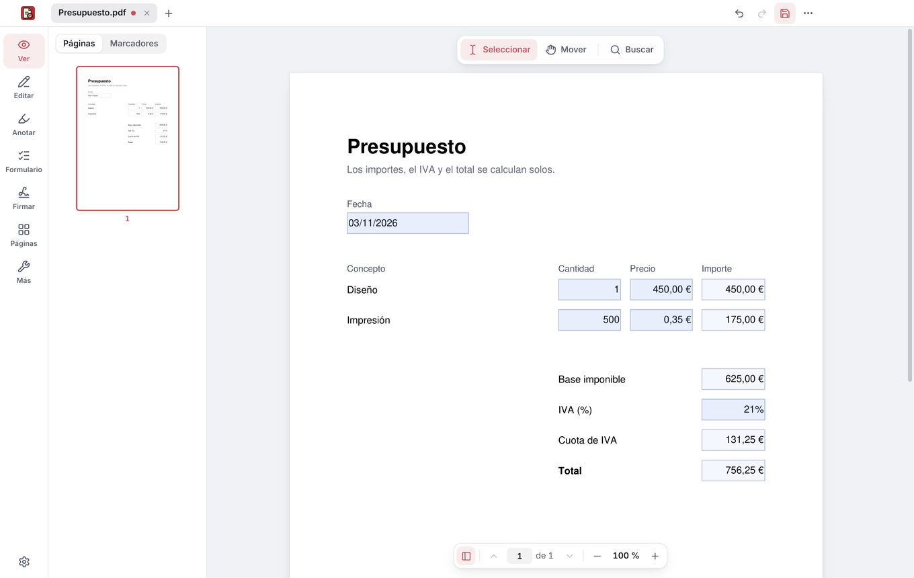
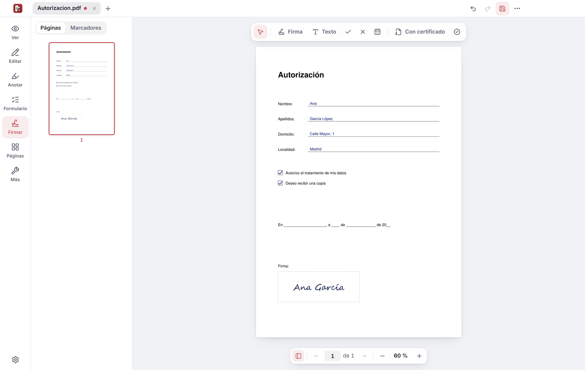
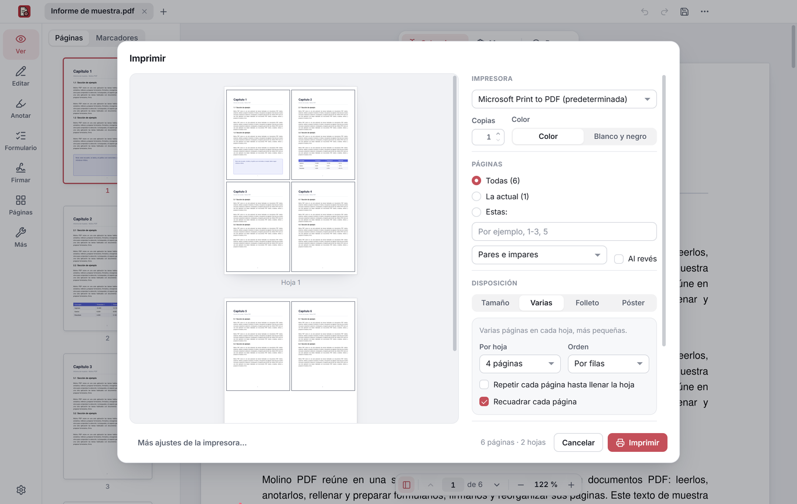

  

<h1 align="center">Molino PDF</h1>

<b>Everything you need to do with a PDF, in one place.</b> 
Read, fill in, sign, edit and organize your PDFs on Windows. Free, no ads, no account, and your documents are never uploaded anywhere.

<a href="../README.en.md">← Molino</a> · <a href="pdf.md">Español</a> · <b>English</b> · <a href="https://molinosuite.org/en/pdf/">molinosuite.org/en/pdf</a>

  

> [!NOTE]
> **The first version is coming very soon.** To hear about it, click **Watch → Custom → Releases** in [the repository](https://github.com/MolinoSuite/Molino).

## ✍️ Fill in and sign

- **Forms that do the math for you:** they add up the amounts, apply the tax and work out the total. Does the PDF have no fields? Type on top of it, wherever you like.
- **Sign by hand**, by drawing, typing your name or using a photo of your signature.
- **Sign with your digital certificate**, such as Spain’s FNMT, with the European standard for PDF (PAdES) and a timestamp included.

  
  

## 🗂️ Edit and organize

- **Edit** the text of the PDF itself and add text, images and shapes.
- **Annotate:** highlight, underline, strike through, add notes or draw freehand.
- **Organize pages:** reorder, rotate, delete, extract, split and combine documents.
- **Print** with a preview: several pages per sheet, booklets to fold, posters across several sheets and two-sided.

## 📷 From paper to PDF

- **Scan paper documents** with photos from your phone or with your scanner or all-in-one printer: it finds the sheet, straightens it, removes the shadows and makes it look freshly scanned.
- **Recognize the text** of scanned documents (OCR) so you can search and copy it.

## 🔒 Protect and share

- **True redaction:** removes from the file the data you black out, not just covers it.
- **Password-protect** (256-bit AES encryption) and **remove hidden data** before sharing.
- **Compress** and **convert** to Word or images.

## 🧠 AI on your computer, optional

Summarizes the document, answers your questions pointing to the pages each answer comes from, searches by meaning, translates and improves texts, and finds personal data to redact. It’s off by default, works offline and your documents never leave your computer. More at [molinosuite.org/en/ai](https://molinosuite.org/en/ai/).

## 🏠 Your documents stay on your computer

Molino PDF works offline and doesn’t ask you for an account. It only uses the Internet when you ask it to (the timestamp of a signature, which receives a fingerprint of the document, never the document itself; feedback you send us; or downloading the AI models, from Hugging Face) and to let you know about new versions. Each PDF opens in an isolated Windows sandbox, so a booby-trapped file can’t touch your other files or connect to the Internet.

## 💻 Installation

For 64-bit Windows 10 and 11, including Windows 11 on Arm laptops. In English and Spanish: it follows the language of Windows.

1. Download **MolinoPDF-Setup** from the [latest version](https://github.com/MolinoSuite/Molino/releases/latest).
2. Open it and follow the steps. You don’t need to be an administrator.
3. Done. When there’s a new version, Molino PDF will let you know.

**Portable version:** download [MolinoPDF-Portable.zip](https://github.com/MolinoSuite/Molino/releases/latest/download/MolinoPDF-Portable.zip), unzip it in any folder and open `Molino.exe`. It keeps its settings in that folder and changes nothing in Windows.

## 💬 Ideas or something not working?

Tell us from Molino PDF, in the **…** menu → **Send feedback**, or in [Issues](https://github.com/MolinoSuite/Molino/issues). It includes third-party components with their own licenses: the list is in **About Molino PDF → Third-party components**.
