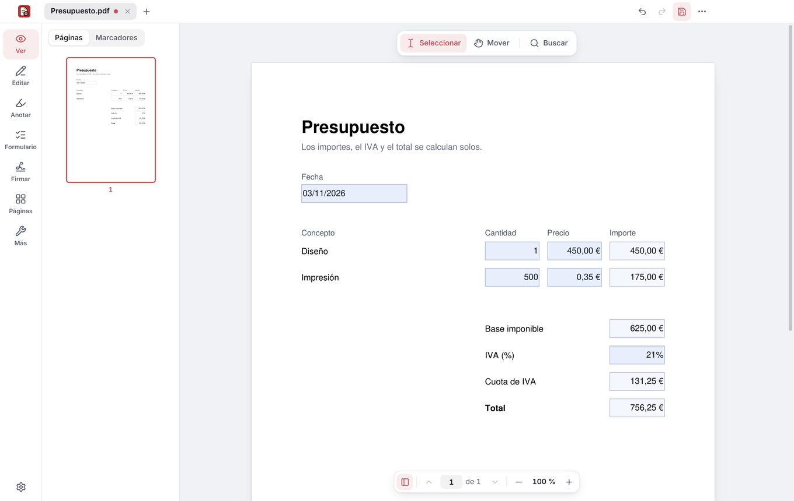
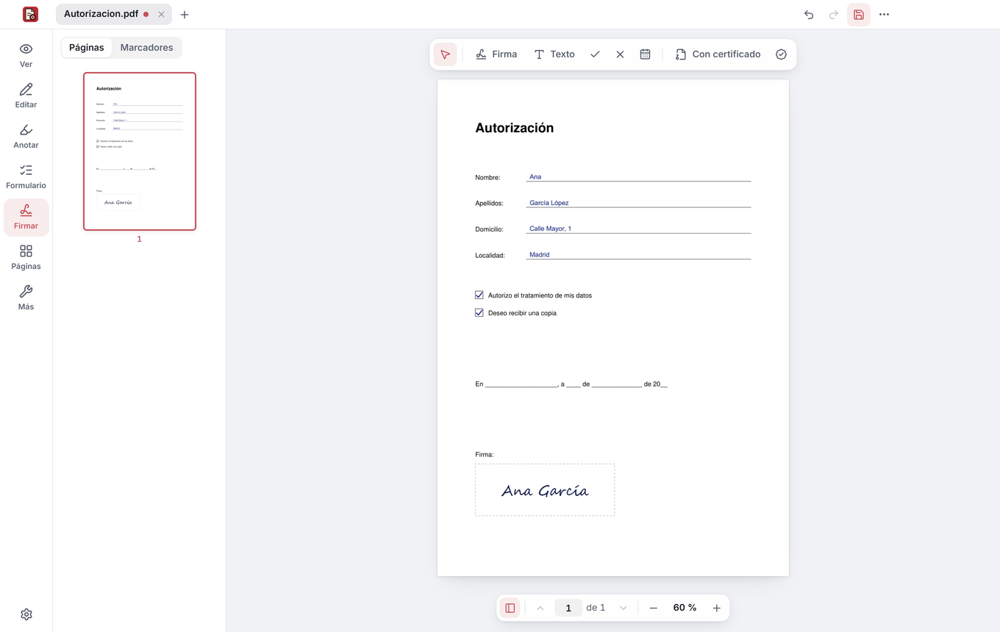
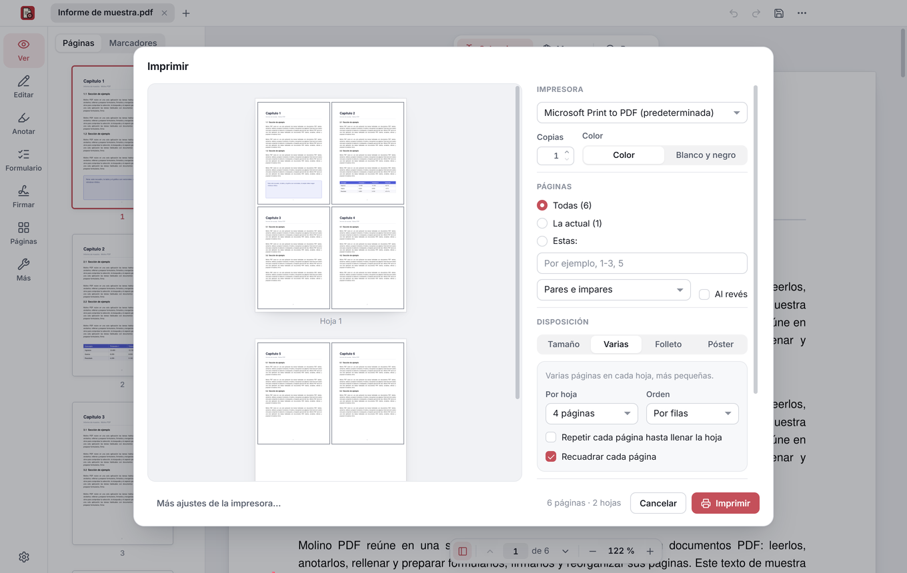

  

<h1 align="center">Molino PDF</h1>

<b>Todo lo que haces con un PDF, en un solo sitio.</b> 
Lee, rellena, firma, edita y organiza tus PDF en Windows. Gratis, sin anuncios, sin cuenta y sin subir tus documentos a ningún sitio.

<a href="../README.md">← Molino</a> · <b>Español</b> · <a href="pdf.en.md">English</a> · <a href="https://molinosuite.org/pdf/">molinosuite.org/pdf</a>

  

> [!NOTE]
> **La primera versión sale muy pronto.** Para enterarte, pulsa **Watch → Custom → Releases** en [el repositorio](https://github.com/MolinoSuite/Molino).

## ✍️ Rellena y firma

- **Formularios que hacen las cuentas solos:** suman los importes, aplican el IVA y sacan el total. ¿El PDF no tiene campos? Escribe encima, donde quieras.
- **Firma a mano**, dibujando, escribiendo tu nombre o con una foto de tu firma.
- **Firma con tu certificado digital**, como el de la FNMT, con el estándar europeo para PDF (PAdES) y sello de tiempo incluido.

  
  

## 🗂️ Edita y organiza

- **Edita** el texto del propio PDF y añade texto, imágenes y formas.
- **Anota:** resalta, subraya, tacha, deja notas o dibuja a mano alzada.
- **Organiza páginas:** ordena, gira, borra, extrae, divide y combina documentos.
- **Imprime** con vista previa: varias páginas por hoja, folletos para doblar, pósteres en varias hojas y a doble cara.

## 📷 Del papel al PDF

- **Digitaliza papeles** con fotos del móvil o con tu escáner o impresora multifunción: encuentra la hoja, la endereza, quita las sombras y la deja como recién escaneada.
- **Reconoce el texto** de los escaneados (OCR) para poder buscarlo y copiarlo.

## 🔒 Protege y comparte

- **Censura de verdad:** borra del archivo los datos que tapas, no solo los cubre.
- **Protege con contraseña** (cifrado AES de 256 bits) y **limpia los datos ocultos** antes de compartir.
- **Comprime** y **convierte** a Word o a imágenes.

## 🧠 IA en tu equipo, opcional

Resume el documento, responde a tus preguntas indicando las páginas de donde sale cada respuesta, busca por significado, traduce y mejora textos y encuentra datos personales para censurarlos. Viene apagada, funciona sin Internet y tus documentos nunca salen de tu equipo. Más en [molinosuite.org/ia](https://molinosuite.org/ia/).

## 🏠 Tus documentos se quedan en tu equipo

Molino PDF funciona sin conexión y no te pide una cuenta. Solo usa Internet cuando tú lo pides (el sello de tiempo de una firma, que recibe una huella del documento y nunca el documento; un comentario que nos envíes; o la descarga de los modelos de la IA, desde Hugging Face). Cada PDF se abre en un espacio aislado de Windows, para que un archivo con trampa no pueda tocar tus otros archivos ni conectarse a Internet.

## 💻 Instalación

Para Windows 10 y 11 de 64 bits, también en portátiles con Windows 11 ARM. En español y en inglés: sigue el idioma de Windows.

1. Busca **Molino PDF** en la Microsoft Store y pulsa **Obtener**. No hace falta ser administrador ni tener cuenta.
2. Listo. Las versiones nuevas llegan solas por la Store.

También con winget: `winget install "Molino PDF" --source msstore`.

## 💬 ¿Ideas o algo que no va bien?

Cuéntanoslo desde Molino PDF, en el menú **…** → **Enviar comentarios**, o en [Issues](https://github.com/MolinoSuite/Molino/issues). Incluye componentes de terceros con sus propias licencias: la lista está en **Acerca de Molino PDF → Componentes de terceros**.
